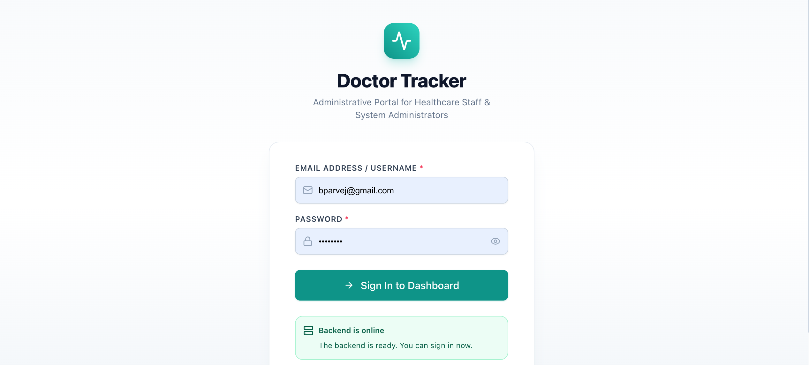
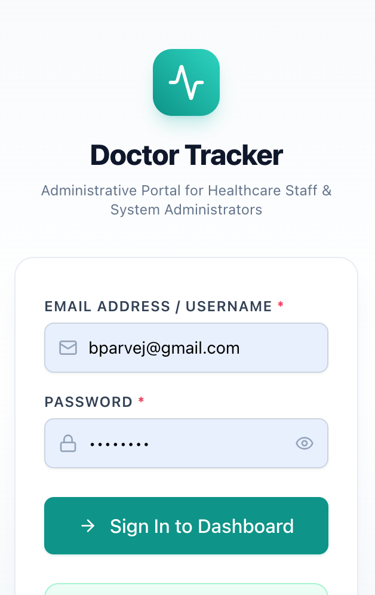
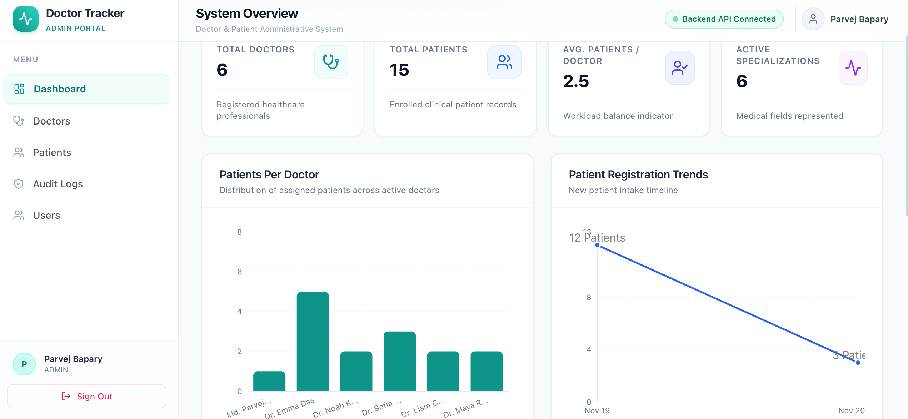
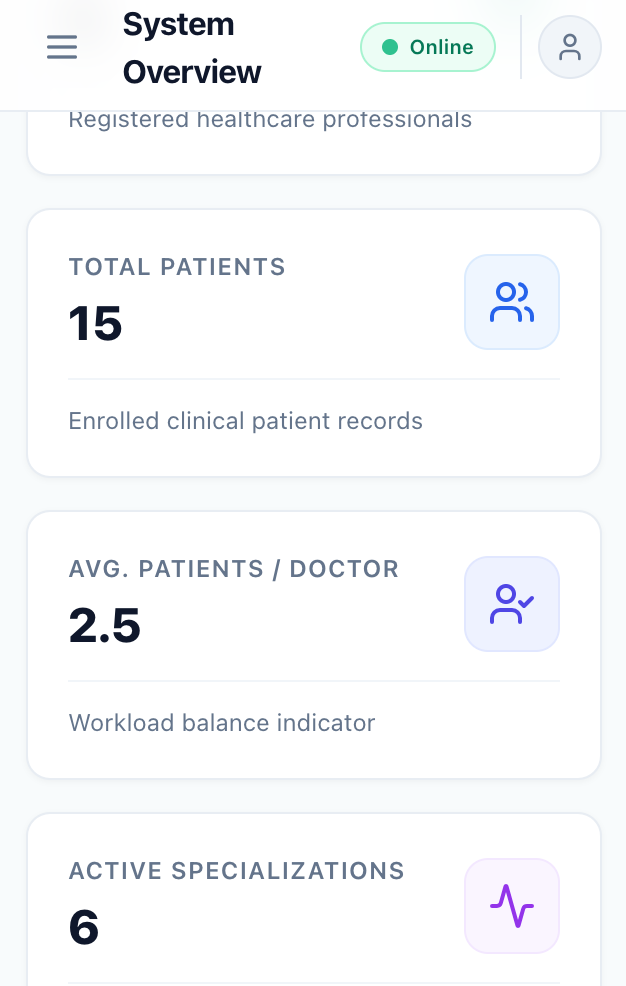
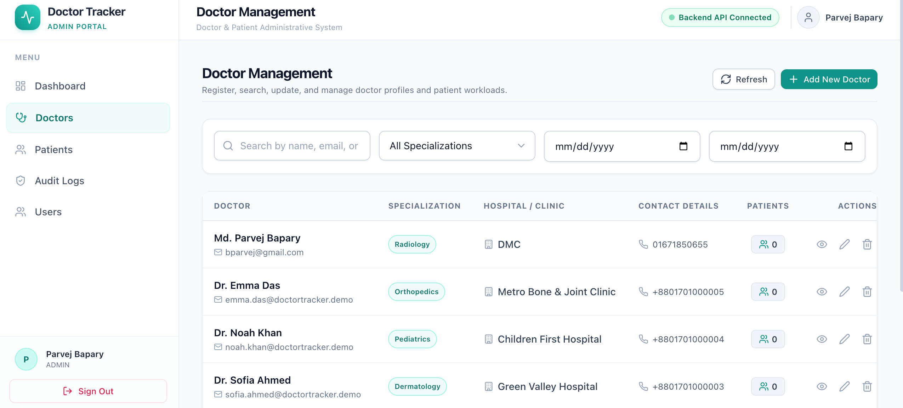
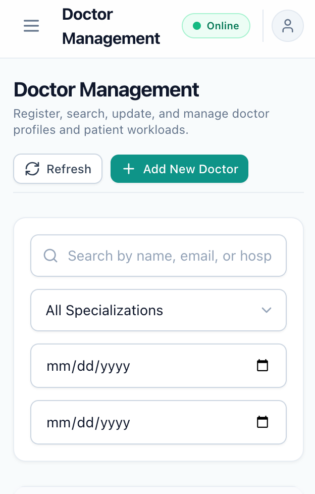
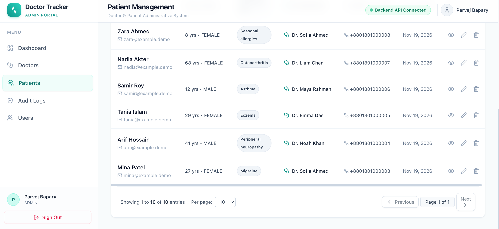
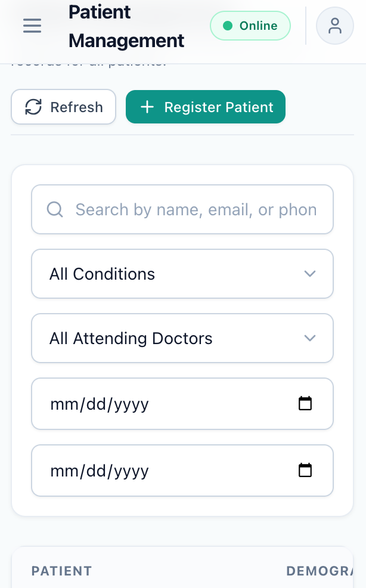
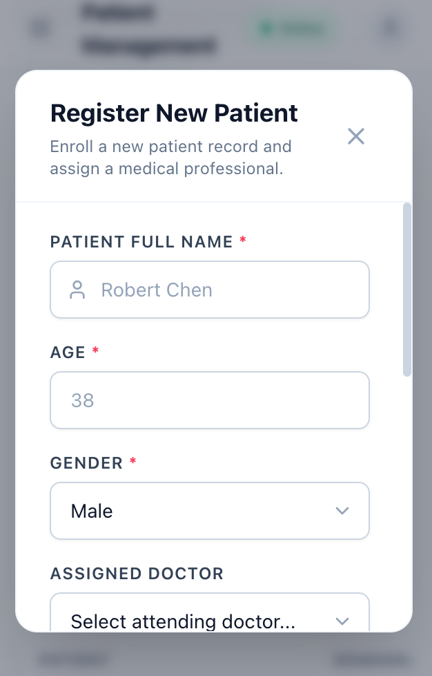

# Doctor Tracker - Frontend Administrative Portal

[](https://nextjs.org/)
[](https://react.dev/)
[](https://tailwindcss.com/)
[](LICENSE)

A modern, responsive, and secure administrative web application engineered for managing medical doctors, patients, clinical assignments, and system audit trails. Doctor Tracker communicates via RESTful JSON APIs with a standalone Express.js + MongoDB backend deployed on Render and is fully containerized and deployable to **Vercel**, **Render**, or any Docker-compatible infrastructure.

**Elevator pitch:** Doctor Tracker is a secure, responsive healthcare administration portal for authorized staff to manage doctor profiles, patient records, clinical assignments, system users, audit trails, and operational analytics. It combines a modern Next.js interface with a separate Node.js/Express REST backend and MongoDB, emphasizing fast server-side filtering and pagination, meaningful Recharts dashboards, role-based access, and resilient backend error handling.

- **Live Backend API**: [https://doctor-tracker-backend-gfj8.onrender.com/api](https://doctor-tracker-backend-gfj8.onrender.com/api)
- **Interactive Swagger Documentation**: [https://doctor-tracker-backend-gfj8.onrender.com/api/docs](https://doctor-tracker-backend-gfj8.onrender.com/api/docs)

---

## 1. Project Overview & Features

### Core Modules

1. **Authentication & Session Management**
   - Clean, secure login and session termination.
   - Bearer token / HttpOnly cookie support with automatic header injection.
   - Global session expiration detection (401 interceptor) and protected client routing.
   - Comprehensive error banners for invalid credentials or offline backend status.

2. **Dashboard & Clinical Analytics**
   - Real-time aggregate statistics: Total Doctors, Total Patients, Workload Ratio, and Active Specializations.
   - **Patients per Doctor**: Interactive Recharts bar chart displaying workload distribution.
   - **Patient Registration Trends**: Recharts line chart illustrating intake trends.
   - **Recent Activity**: Quick-access tables for recently onboarded doctors and registered patients.
   - Integrated with the live `/api/dashboard/stats` backend endpoint.

3. **Doctor Management**
   - Full CRUD operations: Create, Read, Update, Delete with confirmation modals.
   - Metadata tracking: Doctor Name, Specialization, Hospital, Phone, and Email.
   - Server-side search and filters (by specialization, date joined, keyword).
   - Server-side pagination with configurable page sizes (5, 10, 20, 50).
   - **Doctor-Patient Association**: Dedicated modal to inspect patients assigned to a doctor, register new patients directly under that doctor, or unlink patients.

4. **Patient Management**
   - Full CRUD: Register, inspect, edit, and delete patient records.
   - Track Patient Name, Age, Gender (`MALE`, `FEMALE`, `OTHER`), Condition, Attending Doctor, and Contact details.
   - Filters: Patient Condition (Critical, Stable, Under Observation, Recovering), Attending Doctor, and Date of Registration.
   - Server-side debounced search and pagination.

5. **Audit Trail & System Logs**
   - Read-only historical ledger of administrative transactions (`/api/audit-logs`).
   - Tracks Timestamp, User/Actor, Action (CREATE, UPDATE, DELETE, LOGIN, ASSIGN), Entity Type, Entity ID, and Network IP.
   - Searchable and filterable by Action, Entity, and Date range.
   - Detailed modal inspection with automatic sanitization of sensitive keys (passwords, tokens).

6. **Network & Backend Resilience**
   - Continuous backend health detection: Header displays live status (Connected / Offline / Timed out).
   - Informative error banners diagnosing offline status with the target URL (`NEXT_PUBLIC_API_URL`) and actionable Retry controls.
   - ErrorBoundary wrappers to catch unexpected rendering exceptions.

---

## 2. Technology Stack

- **Framework**: Next.js 14 (App Router)
- **Language**: JavaScript ES6 (No TypeScript, purely `.js` / `.jsx`)
- **UI Library**: React 18
- **Styling**: Tailwind CSS
- **Visualization**: Recharts
- **Iconography**: Lucide React
- **HTTP Client**: Native Fetch API (Centralized wrapper with AbortController timeout and retry handling)
- **Containerization**: Docker (Multi-stage Alpine build) & Docker Compose

---

## 3. Directory Structure

```text
doctor-tracker-frontend/
├── app/
│   ├── (auth)/
│   │   └── login/
│   │       └── page.js           # Authentication & sign-in page
│   ├── (dashboard)/
│   │   ├── dashboard/
│   │   │   └── page.js           # Metrics, analytics & charts
│   │   ├── doctors/
│   │   │   └── page.js           # Doctor CRUD, filters, pagination
│   │   ├── patients/
│   │   │   └── page.js           # Patient CRUD, filters, assignments
│   │   ├── audit-logs/
│   │   │   └── page.js           # Audit trail ledger (read-only)
│   │   └── layout.js             # Protected dashboard layout
│   ├── globals.css               # Global Tailwind CSS definitions
│   ├── layout.js                 # Root app layout (providers)
│   └── page.js                   # Root router redirector
├── components/
│   ├── audit/                    # AuditTable, AuditDetailModal
│   ├── charts/                   # Recharts wrappers
│   ├── common/                   # Button, Input, Modal, Badge, Pagination, ErrorBanner, etc.
│   ├── dashboard/                # StatCard, Charts, Recent Tables
│   ├── doctors/                  # DoctorTable, DoctorFormModal, DoctorPatientModal
│   ├── layout/                   # Sidebar, Header, DashboardShell
│   └── patients/                 # PatientTable, PatientFormModal, PatientDetailModal
├── constants/
│   └── config.js                 # Routes, specializations, conditions, pagination limits
├── contexts/
│   ├── AuthContext.js            # Global auth state, session expiry listener
│   └── ToastContext.js           # Global toast notifications
├── hooks/
│   ├── useAuth.js                # Auth consumer hook
│   ├── useDebounce.js            # Debounced search input hook
│   └── useToast.js               # Toast triggers (success, error, warning, info)
├── public/                       # Static assets
├── services/
│   ├── api.js                    # Centralized Fetch wrapper & error handler
│   ├── auth.service.js           # Authentication endpoints
│   ├── doctor.service.js         # Doctor endpoints & doctor-patient endpoints
│   ├── patient.service.js        # Patient endpoints
│   ├── dashboard.service.js      # Dashboard aggregation & metrics
│   └── audit.service.js          # Audit logs retrieval
├── utils/
│   ├── formatters.js             # Dates, phone, strings
│   ├── storage.js                # SSR-safe localStorage wrapper
│   └── validators.js             # Email, phone, form validation
├── .env.example                  # Environment variable reference
├── .env.local                    # Local development configuration
├── Dockerfile                    # Production multi-stage Docker image
├── docker-compose.yml            # Docker Compose configuration
├── next.config.js                # Next.js standalone build configuration
├── tailwind.config.js            # Tailwind color schemes & theme extensions
├── DEVELOPER.md                  # Developer onboarding & contribution guide
├── TECHNICAL.md                  # In-depth architectural & security specification
└── README.md
```

---

## 4. Prerequisites

- **Node.js**: `v18.17.0` or higher (`v20.x` or `v22.x` recommended)
- **Package Manager**: `npm` (v9+) or `pnpm`
- **Docker**: Optional, for containerized local execution

---

## 5. Local Setup & Execution

### 1. Clone & Enter Directory
```bash
git clone <repository-url>
cd doctor-tracker-frontend
```

### 2. Configure Environment Variables
Copy `.env.example` to `.env.local`:
```bash
cp .env.example .env.local
```
Configured with the active Express.js backend on Render:
```env
NEXT_PUBLIC_API_URL=https://doctor-tracker-backend-gfj8.onrender.com/api
NEXT_PUBLIC_API_TIMEOUT=15000
NEXT_PUBLIC_ENV=development
```

### 3. Install Dependencies
```bash
npm install
```

### 4. Run Development Server
```bash
npm run dev
```
Open [http://localhost:3000](http://localhost:3000) in your browser.

---

## 6. Docker Containerization

To run the application inside Docker:

### Using Docker Compose
```bash
docker-compose up --build
```
The application will be compiled and hosted at `http://localhost:3000`.

### Manual Docker Build & Run
```bash
docker build -t doctor-tracker-frontend:latest --build-arg NEXT_PUBLIC_API_URL=https://doctor-tracker-backend-gfj8.onrender.com/api .
docker run -p 3000:3000 doctor-tracker-frontend:latest
```

---

## 7. Cloud Deployment Guides

### Deploying to Vercel
1. Push your repository to GitHub or GitLab.
2. Import the project into the [Vercel Dashboard](https://vercel.com/).
3. Framework preset will automatically detect **Next.js**.
4. In **Environment Variables**, add:
   - `NEXT_PUBLIC_API_URL`: `https://doctor-tracker-backend-gfj8.onrender.com/api`
5. Click **Deploy**.

### Deploying to Render (Web Service or Docker)
- **Option A (Node Service)**:
  - Build Command: `npm install && npm run build`
  - Start Command: `npm run start`
  - Environment Variable: `NEXT_PUBLIC_API_URL=https://doctor-tracker-backend-gfj8.onrender.com/api`
- **Option B (Docker Service)**:
  - Select "Docker" as runtime.
  - Set Build Argument `NEXT_PUBLIC_API_URL` to `https://doctor-tracker-backend-gfj8.onrender.com/api`.

---

## 8. Backend Down & Offline Error Resilience

If the Express.js backend server on Render is paused (spinning down during idle), restarting, or unreachable:
1. **Header Health Pill**: Automatically switches from "Backend API Connected" to "API Offline" or "API Timed Out".
2. **Prominent Error Banners**: Explains that the backend server is unreachable at `NEXT_PUBLIC_API_URL`.
3. **Retry Button**: Allows administrators to re-test backend connectivity once the server has spun back up without refreshing the entire page.

---

## 9. RBAC & User Management

- `NEXT_PUBLIC_API_URL` must be `https://doctor-tracker-backend-gfj8.onrender.com/api`.
- Login is centralized through `POST /auth/login`; the JWT and `data.user` are stored only for authenticated sessions.
- Supported roles are `ADMIN` and `VIEWER`. The `Users` page and navigation item are available only to `ADMIN` users.
- `/auth/me` restores and validates the current session. A `401` response clears the JWT and cached user immediately.
- Every authenticated API request sends `Authorization: Bearer <token>`.
- Admin user CRUD uses `/users` and `/users/:id`. Creation requires name, email, password, role, and isActive; editing password is optional.
- The backend may return `{ success, data, error: { code, message }, requestId }`. Errors and 403 responses are handled through the centralized API client.
- Administrators cannot delete or deactivate themselves or change their own role.

---

## 10. Requirements Coverage & Technical Decisions

### Requirements status

| Requirement area | Status | Evidence |
| :--- | :--- | :--- |
| Authentication and protected routes | Implemented | JWT/Bearer sessions, `/auth/me` restoration, 401 handling, and dashboard layout protection |
| Doctor CRUD and filtering | Implemented | Create, edit, delete, search, specialization/date filters, pagination, and detail views |
| Doctor-patient association | Implemented | Assigned-patient list, register under doctor, and remove/unlink patient actions |
| Patient CRUD and filtering | Implemented | Create, edit, delete, search, condition/doctor/date filters, and pagination |
| Dashboard analytics | Implemented | Live totals and Recharts patients-per-doctor and registration-trend graphs |
| Responsive modern UI/UX | Implemented | Tailwind responsive layouts, cards, modals, loading states, empty states, and toasts |
| Password visibility and form guidance | Implemented | Shared password reveal toggle and clear placeholders across authentication and management forms |
| Server-side search, filtering, pagination | Implemented | Query parameters, debounced search, configurable limits, and backend pagination support |
| Error and backend-resilience handling | Implemented | Centralized API errors, timeout handling, offline detection, retry, and session-expiry notices |
| MongoDB indexing/query optimization | Backend responsibility | Frontend sends optimized paginated/filter parameters; implementation depends on backend indexes and endpoint queries |
| System audit trail | Implemented | Read-only searchable audit records and sanitized detail modal |
| RBAC | Partially implemented | Frontend and API support `ADMIN`/`VIEWER`; final enforcement must be verified in the backend |
| Visual evidence (screenshots) | Implemented | Desktop/mobile screenshots cover login, dashboard, doctor management, patient management, and patient registration |
| Submitted credentials/repository link | Pending | Add the public repository URL and demo credentials securely if required |

### Technical decisions

1. **Next.js App Router + React Context**: App Router groups public and protected screens cleanly, while React Context is lightweight for authentication and toast state. It avoids unnecessary Redux boilerplate for the current application scope.
2. **Native Fetch through a centralized API client**: The shared client avoids a larger HTTP dependency, gives consistent Bearer headers and error handling, supports request timeout handling, and normalizes network, authorization, and HTTP failures.

### System architecture

```text
Browser / Next.js Client
  -> Protected and public route groups
  -> React components and Context providers
  -> Shared REST services (services/*.service.js)
  -> Centralized Fetch API client (services/api.js)
  -> Express REST API
  -> MongoDB
```

### Visual evidence

#### Login page

| Desktop | Mobile |
| :---: | :---: |
|  |  |

#### Dashboard

| Desktop | Mobile |
| :---: | :---: |
|  |  |

#### Doctor management

| Desktop filter and doctor list | Mobile doctor view |
| :---: | :---: |
|  |  |

#### Patient management

| Desktop pagination | Mobile patient list |
| :---: | :---: |
|  |  |

#### Patient registration

Mobile patient registration form:



## 11. License

This project is licensed under the MIT License.
